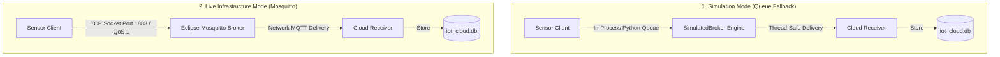

# DEMONSTRATION AND ACCEPTANCE CRITERIA SPECIFICATION
## HYBRID-QKD-BB84-AES256-GCM-MQTT-IOT-PIPELINE
**Branch:** `verification/publication-readiness` | **Head Commit:** `525676d`  
**Author:** Principal Software Architect & QA Lead

---

### Purpose

This document establishes the formal acceptance criteria, test harness specifications, and observable validation procedures for demonstrating the Hybrid QKD-BB84-AES-256-GCM IoT Pipeline. It defines strict behavioral boundaries separating **Simulation Mode (Queue Fallback)** from **Live Infrastructure Mode (Mosquitto Broker)**, and provides explicit pass/fail quantitative thresholds.

---

### Demonstration Modes Overview



---

### 1. Simulation Mode (In-Memory Queue Fallback)

#### 1.1 Prerequisites
* CPython `3.12.x` installed in active virtual environment.
* Dependencies installed: `qiskit`, `qiskit-aer`, `cryptography`, `paho-mqtt`, `flask`, `pandas`, `numpy`, `scipy`.
* Zero external daemons, containers, or network listeners required.

#### 1.2 Execution Command
```powershell
python run_pipeline.py
```

#### 1.3 Startup & Execution Flow
1. **Configuration Initialization:** Pipeline reads `config.py`; logs `Transport Mode: SIMULATED_QUEUE (Fallback)`.
2. **BB84 QKD Negotiation:**
   * Alice prepares $N = 4096$ raw qubits in random $\mathcal{Z}$ and $\mathcal{X}$ bases.
   * Aer simulator executes quantum channel simulation with depolarizing error $p = 0.02$.
   * Bob measures in independent random bases; basis sifting yields $n \approx 2048$ bits.
   * Parameter estimation samples $25\%$ of bits; calculates sample QBER ($e \le 0.05$).
   * Cascade reconciliation executes 4 shuffle-parity passes; achieves zero bit errors.
   * Privacy amplification constructs Toeplitz matrix and extracts master 256-bit key.
   * HKDF derives 256-bit AES-GCM encryption key.
3. **Transport Initialization:**
   * `SimulatedBroker` initializes thread-safe `queue.Queue` channels for topics:
     * `iot/device/SENSOR_SIM_001/telemetry`
     * `iot/device/SENSOR_SIM_001/key_sync`
4. **Subscriber Launch:** Background thread starts `CloudReceiver`, subscribing to topics via queue callback.
5. **Telemetry Generation & Publication:**
   * Sensor client generates 5 synthetic telemetry frames (Temperature, Humidity, Pressure, Voltage).
   * Frames encrypted via AES-256-GCM with strictly monotonic nonces and AAD header binding.
   * Frames published sequentially with 200ms spacing.
6. **Receiver Processing & Database Persistence:**
   * Receiver decapsulates frame, verifies AAD, decrypts payload via AES-256-GCM.
   * Validated records committed to SQLite `iot_cloud.db` (`telemetry_records` table).
7. **Clean Teardown:** Receiver thread gracefully terminated; queue drained; pipeline reports completion.

#### 1.4 Observable Outputs
* Terminal log lines indicating every phase with ISO 8601 timestamps.
* Key identity confirmation: `Alice and Bob master keys match: True`.
* Success message: `All 5 frames successfully published, decrypted, and persisted`.

---

### 2. Live Infrastructure Mode (Mosquitto Broker)

#### 2.1 Prerequisites
* Running Eclipse Mosquitto broker daemon listening on TCP port `1883` (either via Docker or native OS service):
  ```bash
  docker run -d --name mosquitto-qkd -p 1883:1883 eclipse-mosquitto:2
  ```
* Environment variable set: `USE_SIMULATED_BROKER=False`.

#### 2.2 Execution Command
```powershell
$env:USE_SIMULATED_BROKER="False"; python run_pipeline.py
```

#### 2.3 Verification Criteria
1. **Network Socket Establishment:** Client logs `Connecting to PahoLiveClient at localhost:1883...`.
2. **TCP Handshake & Connect Callback:** Receives `CONNACK` with `return_code = 0` (Connection Accepted).
3. **QoS 1 Message Delivery:** Every published frame waits for `PUBACK` before proceeding.
4. **Subscription Routing:** Receiver confirms subscription to `iot/device/+/telemetry` over network.
5. **Payload Decryption:** Decrypts network packets with zero data corruption.
6. **Graceful Broker Disconnect:** Emits `DISCONNECT` frame and closes network sockets cleanly.

---

### 3. Adversarial Demonstration (Eve Intercept-Resend Attack)

#### 3.1 Purpose
Demonstrate that quantum eavesdropping induces detectable error rates that automatically trigger the security abort mechanism before any key material or sensitive data is compromised.

#### 3.2 Execution Command
```powershell
python -m pytest tests/security/test_security.py -k "test_eve_detection" -v
```

#### 3.3 Acceptance Criteria
1. **Eve Interception:** Eve intercepts fraction $\alpha \ge 0.50$ of transmitted qubits in random bases.
2. **QBER Inflation:** Measured QBER inflates from baseline noise ($< 3\%$) to $> 12.5\%$.
3. **Threshold Abort Trigger:** Parameter estimation detects $\text{QBER} > \text{QBER\_ABORT\_THRESHOLD}$ ($0.11$).
4. **Key Abort:** Protocol raises `QKDInterceptionError` or returns `status=ABORTED`.
5. **Zero Key Leakage:** No secret key is emitted; no ciphertext is encrypted under compromised material.
6. **Security Alert Logging:** Alert is recorded in database table `security_alerts`.

---

### 3B. Autonomous Key Lifecycle & Rekeying Demonstration

#### 3B.1 Purpose
Demonstrate that when the active key reaches its configured invocation bound (NIST SP 800-38D), the application automatically pauses publishing, renegotiates a new BB84 key session, updates the receiver, and resumes streaming without data loss or using expired key material.

#### 3B.2 Execution Command
```powershell
python -c "import run_pipeline; run_pipeline.run_rekey_demo(max_key_invocations=3, total_frames=8)"
```

#### 3B.3 Acceptance Criteria
1. **Initial Installation:** Sensor client and cloud receiver establish initial key `KID-1` via BB84 ($N=1536$ qubits).
2. **Threshold Detection:** Frames 1, 2, 3 published under `KID-1`. At invocation 3/3, state transitions to `REKEY_REQUIRED`.
3. **Automatic BB84 Negotiation:** Publishing briefly pauses; a fresh BB84 Qiskit session executes.
4. **Receiver Synchronization:** Receiver installs `KID-2` before publishing resumes; previous key retained in bounded rollover window for in-flight packets.
5. **Seamless Telemetry Resumption:** Frames 4, 5, 6 published under `KID-2`. Frame 7, 8 trigger subsequent rotation to `KID-3`.
6. **Zero Packet Loss:** 100% of frames ($8/8$) decrypted and authenticated by receiver.
7. **Database Persistence:** Sensor readings in `iot_cloud.db` tagged with matching `key_id`; distinct key IDs recorded.

---

### 4. Web Dashboard Demonstration

#### 4.1 Purpose
Provide real-time visual inspection of pipeline operations, QKD parameters, decrypted sensor metrics, and transport mode indicators.

#### 4.2 Execution Command
```powershell
python dashboard/app.py
```
Open web browser to: `http://localhost:5000`

#### 4.3 Observable UI Components
1. **Mode Badge:** Top navigation bar displays a persistent status pill:
   * `[SIMULATED BROKER (QUEUE FALLBACK)]` in yellow when in simulated mode.
   * `[LIVE MOSQUITTO BROKER (PORT 1883)]` in green when connected to live broker.
2. **QKD Session Metrics Card:** Displays active Key Session ID, raw qubit count (4096), sample QBER ($< 5\%$), Cascade leakage, and final 256-bit key status (`ACTIVE`).
3. **Live Telemetry Feed Table:** Displays received sensor frames updating in real time with fields: Device ID, Timestamp, Temperature (°C), Humidity (%), Pressure (hPa), Voltage (V), and Verification Badge (`VERIFIED (AES-GCM-128)`).
4. **Security Status Card:** Shows active defense status (`NORMAL` / `UNDER ATTACK`) with historical Eve detection logs.

---

### 5. Quantitative Acceptance Matrix

| Parameter / Metric | Target Threshold | Validation Method | Pass/Fail Condition |
| :--- | :--- | :--- | :--- |
| **Raw Qubit Processing ($N=4096$)** | $\le 3000 \text{ ms}$ | High-res benchmark timer | Pass if runtime $< 3.0\text{ s}$ |
| **Baseline Channel QBER ($p=0.02$)** | $2.0\% \pm 1.2\%$ | 25% parameter estimation sample | Pass if $0.008 \le e \le 0.035$ |
| **Cascade Key Reconciliation** | $0 \text{ residual bit errors}$ | Full XOR key comparison | Pass if Alice Key == Bob Key |
| **Cascade Efficiency ($f_{\text{EC}}$)** | $1.05 \le f_{\text{EC}} \le 1.30$ | Parity bits / Shannon limit | Pass if $f_{\text{EC}} \le 1.30$ |
| **Privacy Amplification Output** | Exactly 256 bits | Bitstring length check | Pass if $\text{len}(K) == 256$ |
| **AES-256-GCM Encryption Time** | $\le 0.50 \text{ ms}$ per frame | `time.perf_counter_ns` | Pass if mean $< 0.50\text{ ms}$ |
| **Queue Transport Delivery Latency** | $\le 5.0 \text{ ms}$ per frame | E2E timestamp difference | Pass if mean $< 5.0\text{ ms}$ |
| **Live MQTT Roundtrip Latency** | $\le 50.0 \text{ ms}$ per frame | Network timestamp difference | Pass if mean $< 50.0\text{ ms}$ |
| **Ciphertext Tampering Detection** | $100\%$ rejection | 1-bit flip mutation tests | Pass if 0 forged packets accepted |
| **Replay Attack Detection** | $100\%$ rejection | Duplicate frame injection | Pass if duplicate rejected |
| **Eve Interception ($\alpha=1.0$)** | $100\%$ detection | 490 trial statistical audit | Pass if 100% of attacks aborted |
