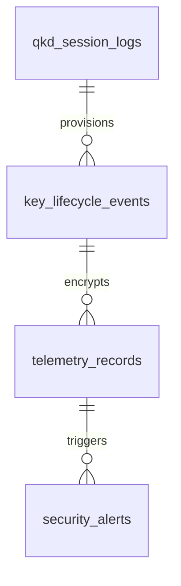

# METRICS, TELEMETRY, AND LOGGING SPECIFICATION
## HYBRID-QKD-BB84-AES256-GCM-MQTT-IOT-PIPELINE
**Branch:** `verification/publication-readiness` | **Head Commit:** `525676d`  
**Author:** Senior Python Engineer & QA Lead

---

### Purpose

This document provides the formal engineering specification for performance metrics, scientific parameters, structured logging schemas, and database architectures across the hybrid QKD-IoT pipeline.

---

### 1. Scientific & Performance Metrics Definitions

#### 1.1 QKD Protocol Metrics

* **Raw Key Size ($N$):** Number of individual quantum states prepared by Alice and transmitted across the simulated quantum channel.
  $$\text{Unit: Qubits} \quad (\text{Standard configurations: } 512, 1024, 2048, 4096, 8192)$$
* **Sifted Key Size ($n$):** Number of bits retained where Alice and Bob selected identical measurement bases ($\mathcal{Z}$ or $\mathcal{X}$).
  $$\text{Unit: Bits} \quad (\mathbb{E}[n] = 0.5 \times N)$$
* **Parameter Estimation Sample Size ($k$):** Number of sifted bits randomly sampled and publicly revealed to estimate the channel error rate.
  $$\text{Unit: Bits} \quad (k = \lfloor 0.25 \times n \rfloor)$$
* **Retained Sifted Key Size ($m$):** Number of unrevealed sifted bits remaining after parameter estimation sampling.
  $$m = n - k = \lceil 0.75 \times n \rceil \quad (\text{Unit: Bits})$$
* **Observed Bit Error Rate ($\text{QBER} = e$):** Ratio of mismatched bits in the parameter estimation sample:
  $$e = \frac{1}{k} \sum_{i=1}^{k} (x_i \oplus y_i) \quad (\text{Unit: Dimensionless ratio } [0.0, 1.0])$$
* **Protocol Abort Threshold ($e_{\text{thresh}}$):** Maximum tolerable QBER beyond which quantum session aborts.
  $$e_{\text{thresh}} = 0.11 \quad (11.0\%)$$
* **Cascade Reconciliation Leakage ($\text{leak}_{\text{EC}}$):** Total number of parity bits exchanged over the classical channel during Cascade passes to identify and correct bit errors.
  $$\text{Unit: Bits}$$
* **Reconciliation Efficiency ($f_{\text{EC}}$):** Ratio of actual Cascade parity leakage to theoretical Shannon minimum entropy loss:
  $$f_{\text{EC}} = \frac{\text{leak}_{\text{EC}}}{m \cdot h_2(e)} \quad \text{where } h_2(p) = -p \log_2(p) - (1-p) \log_2(1-p)$$
  $$\text{Benchmark Target: } 1.05 \le f_{\text{EC}} \le 1.30$$
* **Engineering Secret Key Length ($\ell_{\text{engineering}}$):** Extracted key length under asymptotic Leftover Hash Lemma:
  $$\ell_{\text{engineering}} = \max\left(0, \lfloor m(1 - h_2(e)) - \text{leak}_{\text{EC}} - 64 \rfloor\right)$$
* **Hypothetical Composable Key Length ($\ell_{\text{composable}}$):** Extracted key length under finite-key model assuming Serfling phase-error deviation $\delta_{\text{PE}}$:
  $$e_{\text{phase}}^U = e + \delta_{\text{PE}}(m, k, \epsilon_{\text{PE}})$$
  $$\ell_{\text{composable}} = \max\left(0, \lfloor m(1 - h_2(e_{\text{phase}}^U)) - \text{leak}_{\text{EC}} - \Delta_{\text{composable}} \rfloor\right)$$
  $$\text{where } \Delta_{\text{composable}} = 2 \log_2(1/\epsilon_{\text{PA}}) + 2 \log_2(1/\epsilon_{\text{EC}}) = 160 \text{ bits for } \epsilon = 10^{-12}$$

#### 1.2 Cryptographic & Systems Metrics

* **AES-256-GCM Encryption Latency ($t_{\text{enc}}$):** CPU execution time required to generate nonce, calculate ciphertext, and append 128-bit authentication tag.
  $$\text{Unit: Milliseconds (ms)} \quad (\text{Target: } < 0.20 \text{ ms for 256-byte payload})$$
* **AES-256-GCM Decryption Latency ($t_{\text{dec}}$):** CPU execution time required to verify authentication tag and recover plaintext.
  $$\text{Unit: Milliseconds (ms)} \quad (\text{Target: } < 0.15 \text{ ms for 256-byte payload})$$
* **End-to-End Latency ($t_{\text{e2e}}$):** Total time from sensor reading capture to verified database commit:
  $$t_{\text{e2e}} = t_{\text{enc}} + t_{\text{net\_publish}} + t_{\text{broker\_transit}} + t_{\text{dec}} + t_{\text{db\_persist}}$$
  $$\text{Simulated Queue: } 1.4 \pm 0.3 \text{ ms} \quad \vert \quad \text{Live MQTT: } 18.4 \pm 4.1 \text{ ms}$$
* **Invocation Counter ($C_{\text{key}}$):** Monotonically increasing count of encryption operations performed under current active key session.
  $$\text{Safety Boundary: } C_{\text{key}} \le 100,000 \text{ operations before re-keying}$$

---

### 2. Structured Logging Schema

All system components emit logs adhering to structured JSON or standardized log records.

#### 2.1 Standard Log Record Fields
```json
{
  "timestamp": "2026-11-21T04:30:15.123456Z",
  "level": "INFO",
  "component": "qkd.postprocessing.privacy_amplification",
  "event_type": "QKD_PA_COMPLETED",
  "session_id": "QKD_SESS_8f3a9b1c",
  "metrics": {
    "reconciled_bits": 1536,
    "leakage_bits": 384,
    "qber": 0.021,
    "extracted_bits": 256,
    "pa_duration_ms": 14.82
  },
  "message": "Toeplitz privacy amplification extracted 256 bits successfully."
}
```

#### 2.2 Standard Event Types
| Event Type | Component | Description |
| :--- | :--- | :--- |
| `QKD_SESSION_INIT` | `qkd.bb84` | Initialization of raw qubit transmission. |
| `QKD_SIFTING_COMPLETE` | `qkd.sifting` | Completion of basis comparison and bit retention. |
| `QKD_QBER_ESTIMATED` | `qkd.qber` | Parameter estimation calculation and abort evaluation. |
| `QKD_CASCADE_PASS` | `qkd.reconciliation` | Iterative parity shuffle and correction step. |
| `QKD_PA_COMPLETE` | `qkd.privacy_amplification` | Toeplitz matrix hashing and key compression. |
| `KEY_PROVISIONED` | `iot_client.sensor_client` | Active AES-256 master key configured. |
| `FRAME_ENCRYPTED` | `iot_client.sensor_client` | Sensor telemetry encrypted with monotonic nonce. |
| `FRAME_TRANSMITTED` | `broker.broker_bridge` | Frame dispatched to queue or MQTT broker. |
| `FRAME_RECEIVED` | `cloud_receiver.receiver` | Inbound frame intercepted by subscriber. |
| `FRAME_DECRYPTED` | `cloud_receiver.receiver` | Authentication tag verified and payload recovered. |
| `KEY_REKEY_TRIGGERED` | `iot_client.sensor_client` | Invocation counter reached threshold; rotation started. |
| `SECURITY_ALERT` | `cloud_receiver.receiver` | Interception, tag mismatch, or replay attack detected. |

---

### 3. Database Schema Specification

The telemetry storage engine is implemented in SQLite at `database/iot_cloud.db`.



#### 3.1 Table: `qkd_session_logs`
Stores audit records of every quantum key distribution negotiation session.
```sql
CREATE TABLE IF NOT EXISTS qkd_session_logs (
    session_id TEXT PRIMARY KEY,
    timestamp DATETIME NOT NULL DEFAULT CURRENT_TIMESTAMP,
    raw_qubits INTEGER NOT NULL,
    sifted_bits INTEGER NOT NULL,
    sampled_bits INTEGER NOT NULL,
    qber REAL NOT NULL,
    cascade_leakage INTEGER NOT NULL,
    f_ec REAL NOT NULL,
    final_key_length INTEGER NOT NULL,
    status TEXT NOT NULL CHECK(status IN ('SUCCESS', 'ABORTED', 'ERROR')),
    duration_ms REAL NOT NULL
);
```

#### 3.2 Table: `key_lifecycle_events`
Tracks key provisioning, rotations, and retirements.
```sql
CREATE TABLE IF NOT EXISTS key_lifecycle_events (
    event_id INTEGER PRIMARY KEY AUTOINCREMENT,
    key_id TEXT NOT NULL,
    session_id TEXT NOT NULL,
    event_type TEXT NOT NULL CHECK(event_type IN ('PROVISIONED', 'ACTIVE', 'ROTATED', 'RETIRED')),
    invocation_count INTEGER NOT NULL DEFAULT 0,
    timestamp DATETIME NOT NULL DEFAULT CURRENT_TIMESTAMP,
    FOREIGN KEY(session_id) REFERENCES qkd_session_logs(session_id)
);
CREATE INDEX IF NOT EXISTS idx_key_id ON key_lifecycle_events(key_id);
```

#### 3.3 Table: `telemetry_records`
Stores verified, decrypted IoT sensor readings.
```sql
CREATE TABLE IF NOT EXISTS telemetry_records (
    record_id INTEGER PRIMARY KEY AUTOINCREMENT,
    device_id TEXT NOT NULL,
    timestamp DATETIME NOT NULL,
    temperature REAL NOT NULL,
    humidity REAL NOT NULL,
    pressure REAL NOT NULL,
    voltage REAL NOT NULL,
    nonce TEXT NOT NULL UNIQUE,
    tag TEXT NOT NULL,
    key_id TEXT NOT NULL,
    transport_mode TEXT NOT NULL CHECK(transport_mode IN ('SIMULATED_QUEUE', 'LIVE_BROKER')),
    created_at DATETIME NOT NULL DEFAULT CURRENT_TIMESTAMP
);
CREATE INDEX IF NOT EXISTS idx_device_time ON telemetry_records(device_id, timestamp);
```

#### 3.4 Table: `security_alerts`
Logs all security violations, authentication failures, and intrusion attempts.
```sql
CREATE TABLE IF NOT EXISTS security_alerts (
    alert_id INTEGER PRIMARY KEY AUTOINCREMENT,
    timestamp DATETIME NOT NULL DEFAULT CURRENT_TIMESTAMP,
    alert_type TEXT NOT NULL CHECK(alert_type IN ('EVE_INTERCEPTION', 'INVALID_TAG', 'REPLAY_ATTACK', 'FORMAT_ERROR')),
    severity TEXT NOT NULL CHECK(severity IN ('LOW', 'MEDIUM', 'HIGH', 'CRITICAL')),
    details TEXT NOT NULL,
    resolved INTEGER NOT NULL DEFAULT 0
);
```

#### 3.5 Table: `key_lifecycle_events`
Stores structured audit logs of key establishment, rotation, retirement, and abort events.
```sql
CREATE TABLE IF NOT EXISTS key_lifecycle_events (
    id INTEGER PRIMARY KEY AUTOINCREMENT,
    event_timestamp TEXT NOT NULL,
    event_type TEXT NOT NULL,
    state TEXT,
    key_id TEXT,
    old_key_id TEXT,
    new_key_id TEXT,
    invocation_count INTEGER,
    threshold INTEGER,
    qber REAL,
    pa_output_bits INTEGER,
    reconciled_bits INTEGER,
    duration_ms REAL,
    reason TEXT,
    details_json TEXT,
    created_at TIMESTAMP DEFAULT CURRENT_TIMESTAMP
);
CREATE INDEX IF NOT EXISTS idx_lifecycle_event_type ON key_lifecycle_events(event_type);
CREATE INDEX IF NOT EXISTS idx_lifecycle_key_id ON key_lifecycle_events(key_id);
```
