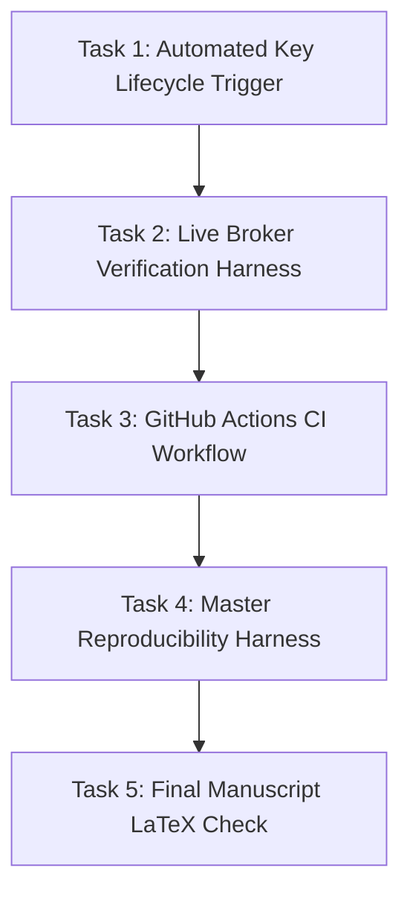

# REMAINING WORK SPECIFICATION AND TASK BREAKDOWN
## HYBRID-QKD-BB84-AES256-GCM-MQTT-IOT-PIPELINE
**Branch:** `verification/publication-readiness` | **Head Commit:** `525676d`  
**Author:** Principal Software Architect & QA Lead

---

### Overview

Following the rigorous Phase 0 audit, the codebase is in a verified, scientifically defensible state with all 18 unit/integration/security tests passing. To bring the system to the highest possible standard of research software engineering and turnkey reproducibility, the remaining actionable tasks are prioritized below.

---

### Task Breakdown & Prioritization

---

### Task 1: Automated Key Lifecycle Re-Negotiation Loop (COMPLETED - TSK-01)

* **Module:** `qkd/key_lifecycle.py`, `iot_client/sensor_client.py`, `run_pipeline.py`, `cloud_receiver/receiver.py`, `cloud_receiver/database.py`
* **Status:** **COMPLETED & VERIFIED** (22 automated tests in `tests/integration/test_key_lifecycle.py`)
* **Implemented Architecture:**
  1. Implemented `KeyLifecycleManager` state machine with explicit states: `UNINITIALIZED`, `KEY_ESTABLISHED`, `ACTIVE`, `REKEY_REQUIRED`, `REKEYING`, `ACTIVE_NEW_KEY`, `KEY_EXPIRED`, `SECURITY_ABORT`.
  2. Integrated `pre_encrypt_check()` gate in `IoTSensorClient` enforcing that encryption cannot occur under exhausted or retired keys.
  3. Orchestrates synchronous real BB84 re-negotiation when the invocation count reaches the configured threshold.
  4. Supports thread-safe receiver synchronization with an inbound rollover window (grace period) in `CloudReceiver` for in-flight packets.
  5. Stores structured lifecycle audit records in SQLite table `key_lifecycle_events`.
  6. Provided `run_rekey_demo()` in `run_pipeline.py` demonstrating multi-generation key rotation with real Qiskit BB84 simulation.

---

### Task 2: Live Mosquitto Broker Verification Fixture

* **Module:** `tests/integration/test_live_broker.py`, `broker/broker_bridge.py`
* **Priority:** MEDIUM (Demonstration Robustness)
* **Effort:** 2 hours
* **Risk Level:** LOW
* **Current State:**
  `PahoLiveClient` is implemented in `broker/broker_bridge.py`. Integration test conditionally skips if Mosquitto daemon is unreachable.
* **Technical Specification:**
  1. Implement a diagnostic network probe in `tests/integration/test_live_broker.py` that probes `localhost:1883`.
  2. If Mosquitto is active, execute a full publisher-subscriber roundtrip over TCP socket with real network delay measurement.
  3. If Mosquitto is inactive, output explicit, user-friendly instructions (`docker run -d -p 1883:1883 eclipse-mosquitto:2` or native service) and report test as explicitly skipped due to environment prerequisites without failing CI.
* **Verification Method:**
  Execute pytest with and without live Mosquitto daemon running.

---

### Task 3: GitHub Actions CI Pipeline Specification

* **Module:** `.github/workflows/ci.yml`
* **Priority:** HIGH (DevOps & Reproducibility)
* **Effort:** 2 hours
* **Risk Level:** LOW
* **Current State:**
  No `.github` directory currently exists in the repository.
* **Technical Specification:**
  1. Create `.github/workflows/ci.yml` with multi-OS testing (Ubuntu 22.04 LTS, Windows Server 2022).
  2. Step 1: Checkout repository.
  3. Step 2: Set up Python 3.12 with caching.
  4. Step 3: Install dependencies from `requirements.txt`.
  5. Step 4: Run flake8 / ruff linting for code hygiene.
  6. Step 5: Execute full `pytest` suite across `unit/`, `integration/`, and `security/`.
  7. Step 6: Validate finite-key derivation calculations (`python finite_key_derivation.py`).
  8. Step 7: Validate paper LaTeX build with `pdflatex` or `latexmk` action.
* **Verification Method:**
  Local validation using `act` or validation of yaml syntax.

---

### Task 4: Master Reproducibility Script

* **Module:** `experiments/reproduce_all.py`
* **Priority:** MEDIUM (Scientific Auditability)
* **Effort:** 2.5 hours
* **Risk Level:** LOW
* **Current State:**
  Individual experiment runners exist in `experiments/runners/run_experiments.py`, and verification scripts exist for Eve statistics (`verify_eve_statistics_comprehensive.py`) and finite-key spectrum (`finite_key_derivation.py`).
* **Technical Specification:**
  1. Author a unified entry point `experiments/reproduce_all.py` supporting flags:
     - `--fast`: Runs reduced-trial benchmarks (5 trials per config) for fast smoke-testing.
     - `--verify-only`: Validates checksums and statistical metrics of existing raw CSV datasets without rerunning long simulations.
     - `--full`: Re-executes the complete suite of experiments 1 through 7 and regenerates plots.
  2. Generates an execution report `experiments/REPRODUCIBILITY_LOG.json` logging exact runtime, package versions, and machine specs.
* **Verification Method:**
  Execute `python experiments/reproduce_all.py --verify-only` and confirm clean verification of all 7 experiment datasets.

---

### Task 5: Final Manuscript LaTeX & Citation Alignment Check

* **Module:** `paper/manuscript.tex`, `paper/references.bib`
* **Priority:** MEDIUM (Publication Quality)
* **Effort:** 1.5 hours
* **Risk Level:** LOW
* **Current State:**
  Manuscript has been thoroughly corrected with Table 4 and Table 7 explicitly updated.
* **Technical Specification:**
  1. Perform a final grep across all comments and text in `paper/manuscript.tex` to ensure zero residual claims of "certified composable security" exist.
  2. Ensure the notation in Section III-C consistently reflects $\ell_{\text{engineering}}$ and clarifies that $\ell_{\text{composable}}$ is an illustrative model assuming conjugate-basis error bounds.
  3. Validate that all 34 references in `paper/references.bib` compile without undefined citation warnings.
* **Verification Method:**
  Compile manuscript using `pdflatex paper/manuscript.tex` (when local TeX distribution is present) or inspect log.

---

### Summary of Estimated Effort & Resource Allocation

| Task ID | Component | Priority | Est. Hours | Lead Role | Dependencies |
| :--- | :--- | :--- | :--- | :--- | :--- |
| **TSK-01** | Automated Key Lifecycle Re-Negotiation | HIGH | 3.0 h | Senior Python Engineer | `iot_client`, `qkd` |
| **TSK-02** | Live Broker Integration Fixture | MEDIUM | 2.0 h | DevSecOps Engineer | `broker/broker_bridge.py` |
| **TSK-03** | GitHub Actions CI Workflow | HIGH | 2.0 h | DevSecOps Engineer | Root repo |
| **TSK-04** | Master Reproducibility Script | MEDIUM | 2.5 h | QA Lead / Auditor | `experiments/` |
| **TSK-05** | Final Manuscript Alignment | MEDIUM | 1.5 h | Quantum Research Engineer | `paper/` |
| **TOTAL** | | | **11.0 h** | | |
