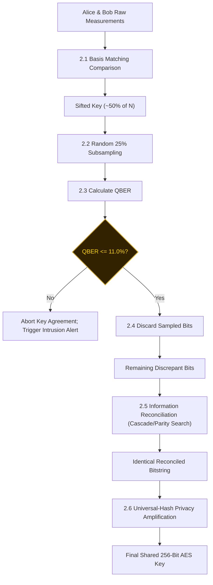
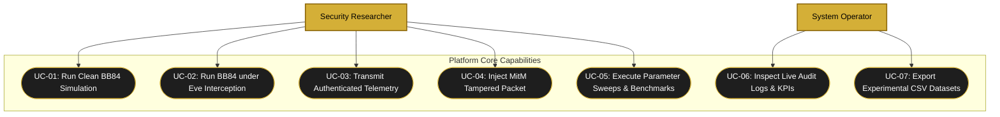
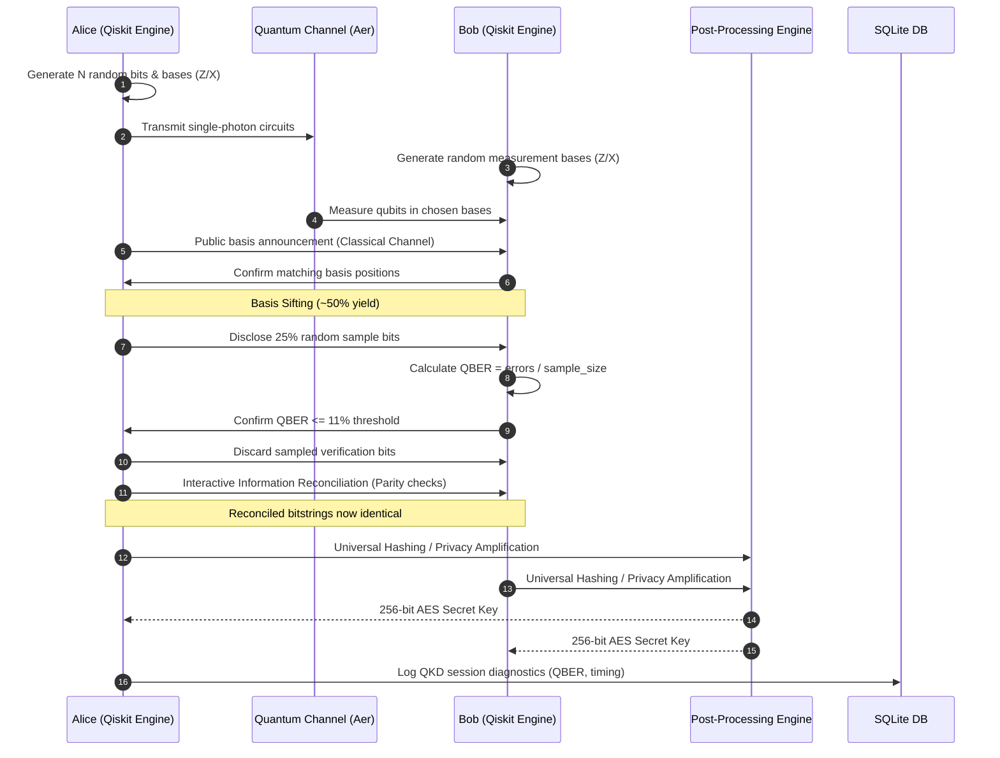
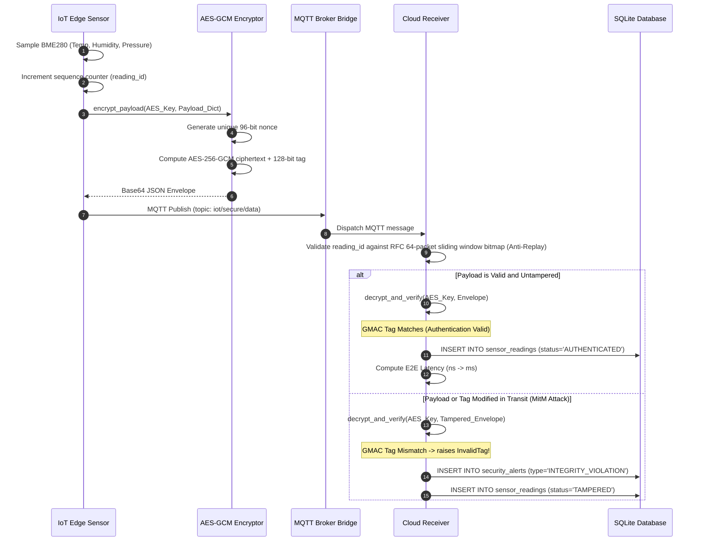

# System Architecture Document (SAD)

**Project Title:** Hybrid BB84 Quantum Key Distribution and AES-256 Encryption for Secure Cloud-Based IoT Communication  
**Document Version:** 1.0.0  
**Date:** November 2026

---

## 1. System Overview & Context Diagram (C4 Level 1)

The system context diagram illustrates the interaction between external actors and the major logical domains of the platform:

```mermaid
graph TD
    classDef actorStyle fill:#D4AF37,stroke:#8B6508,stroke-width:2px,color:#000000;
    classDef systemStyle fill:#1A1A1A,stroke:#D4AF37,stroke-width:2px,color:#FFFFFF;
    classDef extStyle fill:#2A2A2A,stroke:#666666,stroke-width:1px,color:#DDDDDD;

    User["Researcher / Systems Evaluator"]:::actorStyle
    Attacker["Quantum / Classical Adversary (Eve / MitM)"]:::actorStyle

    subgraph CorePlatform ["Hybrid Quantum-Safe IoT Security Platform"]
        QKDModule["Module A: Qiskit BB84 Simulator & Post-Processing"]:::systemStyle
        IoTEdge["Module B: IoT Edge Sensor & AES-256-GCM Client"]:::systemStyle
        MQTTBroker["Module C: MQTT Broker Bridge (Queue / Mosquitto)"]:::systemStyle
        CloudReceiver["Module D: Cloud Decryption & Anti-Replay Ingestion"]:::systemStyle
        Storage["Module E: SQLite Persistent Audit Storage"]:::systemStyle
        Dashboard["Module F: Real-time Golden-Black Web Dashboard"]:::systemStyle
    end

    User -->|Triggers BB84 & Experiments| Dashboard
    User -->|Views Live KPIs & Telemetry| Dashboard
    Attacker -.->|Intercepts Qubits (QBER ~25%)| QKDModule
    Attacker -.->|Modifies Ciphertext / Replays| MQTTBroker

    QKDModule -->|Shared 256-bit Key| IoTEdge
    QKDModule -->|Shared 256-bit Key| CloudReceiver
    IoTEdge -->|Publishes Encrypted Envelopes| MQTTBroker
    MQTTBroker -->|Dispatches Messages| CloudReceiver
    CloudReceiver -->|Persists Verified Data & Alerts| Storage
    Storage -->|Queries Stats & Readings| Dashboard
```

---

## 2. Level 1 Data Flow Diagram (DFD)

The Level 1 DFD decomposes the system into primary computational processes and data stores:

```mermaid
graph LR
    classDef procStyle fill:#1A1A1A,stroke:#D4AF37,stroke-width:2px,color:#FFFFFF;
    classDef storeStyle fill:#000000,stroke:#8B6508,stroke-width:2px,color:#D4AF37;
    classDef entStyle fill:#222222,stroke:#555555,stroke-width:1px,color:#FFFFFF;

    Alice["Alice (Transmitter)"]:::entStyle
    Bob["Bob (Receiver)"]:::entStyle
    Sensor["BME280 Sensor Client"]:::entStyle
    Cloud["Cloud Telemetry Service"]:::entStyle

    P1["1.0 Quantum State Simulation (Qiskit Aer)"]:::procStyle
    P2["2.0 Sifting, Reconciliation & Privacy Amplification"]:::procStyle
    P3["3.0 AES-256-GCM Envelope Encryption"]:::procStyle
    P4["4.0 MQTT Publish / Subscribe Dispatch"]:::procStyle
    P5["5.0 GMAC Verification & Anti-Replay Ingestion"]:::procStyle

    D1[("DS1: QKD Sessions Store")]:::storeStyle
    D2[("DS2: Active Keys Buffer")]:::storeStyle
    D3[("DS3: Telemetry & Alerts Store")]:::storeStyle

    Alice -->|Quantum States (Z, X)| P1
    P1 -->|Measurement Counts| Bob
    P1 -->|Raw Sifted Bits| P2
    P2 -->|Session Diagnostics| D1
    P2 -->|256-Bit Secret Key| D2
    
    D2 -->|Active Key| P3
    Sensor -->|Raw Telemetry Dict| P3
    P3 -->|Encrypted JSON Envelope| P4
    P4 -->|MQTT Topic Dispatch| P5
    D2 -->|Active Key| P5
    P5 -->|Verified Readings & Tamper Alerts| D3
    D3 -->|Historical Data| Cloud
```

---

## 3. Level 2 Data Flow Diagram (DFD: QKD Post-Processing)



---

## 4. Use Case Diagram



---

## 5. Sequence Diagrams

### 5.1 Sequence 1: End-to-End Clean Quantum Key Agreement & Post-Processing


### 5.2 Sequence 2: IoT Telemetry Ingestion, Anti-Replay, and Tamper Detection

