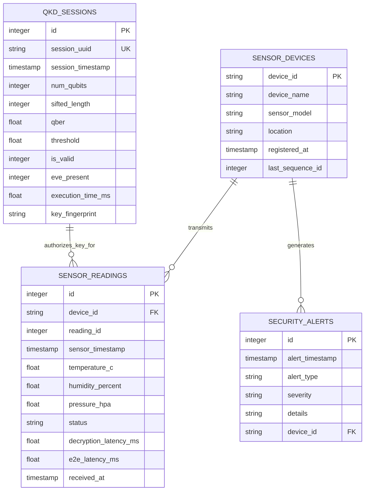

# Database Schema Specification

**Project Title:** Hybrid BB84 Quantum Key Distribution and AES-256 Encryption for Secure Cloud-Based IoT Communication  
**Database Engine:** SQLite 3 (ACID compliant, Write-Ahead Logging `WAL` mode)  
**Database File:** `database/iot_cloud.db`  
**Schema Version:** 1.1.0  
**Date:** November 2026

---

## 1. Entity-Relationship Overview



---

## 2. Table Definitions (DDL)

### Table 1: `sensor_devices`
Tracks registered IoT sensor endpoints and stores the monotonic sequence watermark for anti-replay verification:
```sql
CREATE TABLE IF NOT EXISTS sensor_devices (
    device_id TEXT PRIMARY KEY,
    device_name TEXT NOT NULL,
    sensor_model TEXT DEFAULT 'BME280',
    location TEXT DEFAULT 'Field Node 01',
    registered_at TIMESTAMP DEFAULT CURRENT_TIMESTAMP,
    last_sequence_id INTEGER DEFAULT 0
);
```

### Table 2: `qkd_sessions`
Maintains an immutable forensic audit trail of all quantum key agreement sessions:
```sql
CREATE TABLE IF NOT EXISTS qkd_sessions (
    id INTEGER PRIMARY KEY AUTOINCREMENT,
    session_uuid TEXT UNIQUE NOT NULL,
    session_timestamp TIMESTAMP NOT NULL,
    num_qubits INTEGER NOT NULL,
    sifted_length INTEGER NOT NULL,
    qber REAL NOT NULL,
    threshold REAL NOT NULL DEFAULT 0.11,
    is_valid INTEGER NOT NULL CHECK (is_valid IN (0, 1)),
    eve_present INTEGER NOT NULL CHECK (eve_present IN (0, 1)),
    execution_time_ms REAL NOT NULL,
    key_fingerprint TEXT NOT NULL
);

CREATE INDEX IF NOT EXISTS idx_qkd_timestamp ON qkd_sessions(session_timestamp);
CREATE INDEX IF NOT EXISTS idx_qkd_valid ON qkd_sessions(is_valid);
```

### Table 3: `sensor_readings`
Stores decrypted telemetry and integrity verification status:
```sql
CREATE TABLE IF NOT EXISTS sensor_readings (
    id INTEGER PRIMARY KEY AUTOINCREMENT,
    device_id TEXT NOT NULL,
    reading_id INTEGER,
    sensor_timestamp TEXT,
    temperature_c REAL,
    humidity_percent REAL,
    pressure_hpa REAL,
    status TEXT NOT NULL CHECK (status IN ('AUTHENTICATED', 'TAMPERED', 'REPLAY_REJECTED', 'DROPPED')),
    decryption_latency_ms REAL NOT NULL DEFAULT 0.0,
    e2e_latency_ms REAL NOT NULL DEFAULT 0.0,
    received_at TIMESTAMP DEFAULT CURRENT_TIMESTAMP,
    FOREIGN KEY (device_id) REFERENCES sensor_devices(device_id) ON DELETE CASCADE
);

CREATE INDEX IF NOT EXISTS idx_readings_device_status ON sensor_readings(device_id, status);
CREATE INDEX IF NOT EXISTS idx_readings_received ON sensor_readings(received_at);
```

### Table 4: `security_alerts`
Logs cryptographic exceptions, tamper incidents, and QBER intrusion alerts:
```sql
CREATE TABLE IF NOT EXISTS security_alerts (
    id INTEGER PRIMARY KEY AUTOINCREMENT,
    alert_timestamp TIMESTAMP DEFAULT CURRENT_TIMESTAMP,
    alert_type TEXT NOT NULL,
    severity TEXT NOT NULL CHECK (severity IN ('LOW', 'MEDIUM', 'HIGH', 'CRITICAL')),
    details TEXT NOT NULL,
    device_id TEXT,
    FOREIGN KEY (device_id) REFERENCES sensor_devices(device_id) ON DELETE SET NULL
);

CREATE INDEX IF NOT EXISTS idx_alerts_timestamp ON security_alerts(alert_timestamp);
CREATE INDEX IF NOT EXISTS idx_alerts_type ON security_alerts(alert_type);
```

---

## 3. Data Integrity & Security Policies
1. **Zero Secret Key Plaintext Storage:** Under no circumstances are raw 256-bit AES keys or raw quantum bitstrings persisted to disk. Only non-reversible cryptographic key fingerprints (first 16 hex chars of key digest) are stored for session reconciliation.
2. **Anti-Replay Validation:** On insertion, the cloud receiver queries `sensor_devices.last_sequence_id`. If `reading_id <= last_sequence_id`, the reading is flagged `REPLAY_REJECTED` and a `HIGH` severity alert is logged.
3. **Database Concurrency:** Initialized with `PRAGMA journal_mode=WAL;` and `PRAGMA synchronous=NORMAL;` to guarantee thread-safe concurrent reads from the Flask dashboard and writes from the MQTT cloud subscriber.
